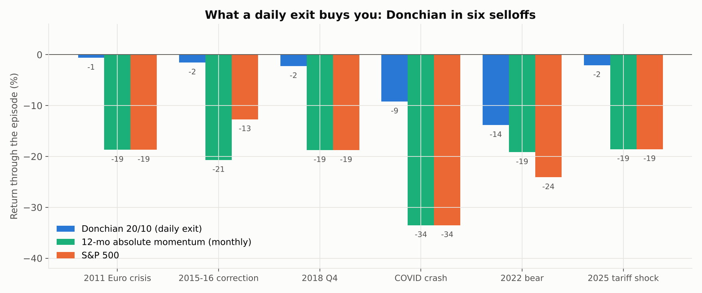

# Donchian channel breakout — backtested

Strategy Lab article #3. The rule taught to the Turtle traders in 1983: buy a new 20-day high,
sell a new 10-day low. Tested on the S&P 500 from 1987 to 2026, and compared against the two
monthly trend filters from articles [#1](https://github.com/AlgoStrategyLab/dual-momentum) and
[#2](https://github.com/AlgoStrategyLab/sma-trend-filter).

**Backtest:** 2 Jan 1987 – 28 Oct 2026 (39.8 years) · VFINX / VBMFX · **daily** evaluation ·
next-close execution · 10 bps costs.

| | Donchian 20/10 | SMA (10 mo) | Momentum (12 mo) | S&P 500 |
| --- | --- | --- | --- | --- |
| Growth of $1 | $7.60 | $35.80 | $55.80 | **$70.10** |
| CAGR | 5.24% | 9.40% | 10.63% | 11.26% |
| Volatility | 10.1% | 14.1% | 14.5% | 18.3% |
| Sharpe | 0.56 | 0.71 | 0.77 | 0.68 |
| Max drawdown | –35.8% | –35.2% | –33.8% | –55.2% |
| Annual turnover | 2,444% | 239% | 133% | 3% |



## Key findings

- **The daily exit genuinely solves the fast-crash problem** that monthly filters structurally
  cannot: COVID –9.2% vs –33.5%, 2018 Q4 –2.3% vs –18.8%, 2025 tariff shock –2.1% vs –18.6%.
- **The breakout signal predicts nothing.** After a 20-day breakout the S&P was higher 20 days
  later 67.1% of the time, against a 65.1% base rate — and the average forward return was
  *lower* than on a random day (+0.83% vs +0.94%), across 243 entries.
- **No cell in the parameter grid beats buy-and-hold.** The best (55-day entry / 50-day exit)
  returns 8.52%; the famous 20/10 returns 5.24%; every 5-day exit loses money.
- **Costs decide the outcome.** 7.84% frictionless, 5.24% at 10 bps, 1.44% at 25 bps,
  **–4.61% at 50 bps** — at 24 switches a year the broker, not the signal, determines the result.
- **Volatility sizing makes it safer, not better:** same 5.2% return, max drawdown 35.8% → 19.4%.
- **Naive ETF diversification made it worse** (1.31% across six assets) — though this is *not*
  a fair proxy for the Turtles' leveraged, long/short futures portfolio. See the article's caveats.
- **Worst drawdown: Jan 1999 → Mar 2009, recovered May 2013.** Fourteen years underwater, caused
  by chop rather than any crash.

## Reproduce

```bash
pip install -r requirements.txt
python run.py                       # ~5 min
python make_charts.py
python site_build/make_tables.py
```

## Files

| File | What it is |
| --- | --- |
| `strategy.py` | `DonchianBreakout`, `DonchianVolSized`, and the channel state machine |
| `run.py` | Main run, signal-edge test, parameter grid, cost sweep, in/out-of-sample split, walk-forward, six-asset basket test |
| `make_charts.py` | The six article charts |
| `output/donchian_summary.json` | Every result in the article |

Article: **[Read it here](https://algostrategylab.github.io/donchian-breakout/)**.
Engine: [strategylab-core](https://github.com/AlgoStrategyLab/strategylab-core) (v0.3.0 adds daily rebalancing).

MIT licensed. Research and education only, not investment advice.
